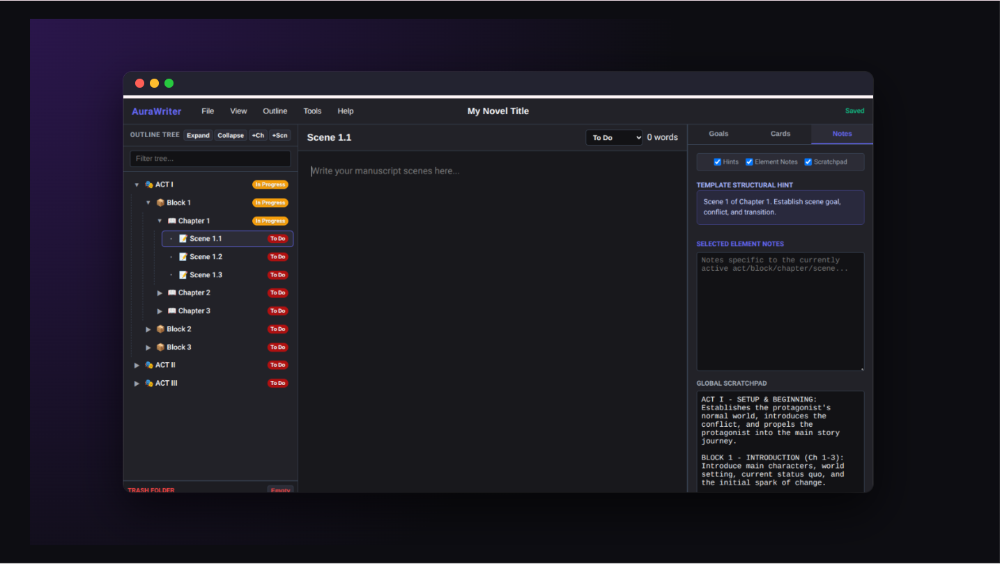

This repository contains the core AuraWriter experience, giving you everything you need to start structuring your story right away.

**Features include:**
* **Interactive Outline Trees:** Visually map out your narrative flow and reorganize scenes on the fly.
* **The 27 Chapter Method:** Built-in structural templates to guide your pacing and plot points.
* **Zero Installation:** Runs as a single HTML file.

👉 **[Launch the Free Web Version Here - Insert GitHub Pages Link]**
*(You can also download the `index.html` file from this repository to run it entirely offline!)*

---

### 2. AuraWriter Pro (Premium)
Ready to build a complete story bible? **AuraWriter Pro** is the ultimate offline outlining experience, packed with advanced tools to manage every aspect of your novel.

**Pro Features include:**
* 🎬 **Save the Cat Framework:** Access industry-standard beat sheets for tight, cinematic pacing.
* 🗂️ **Reference Card Manager:** Keep track of character profiles, world-building settings, and complex plot threads all in one place.
* 📊 **Word Count Goal Calculators:** Built-in tracking to keep your daily writing momentum on schedule.
* 💾 **JSON Export/Import:** Seamlessly save your entire project locally to a single JSON file, and load it back whenever you need.
*    **Toggle Note Fields:** Get more screen space by toggling any of the Notes elements on or off.
*    **Categories & Status:** Add your own terms for Categories and Progress with color.
*    **Expand/Collapse Tree:** Close all folders at the same time or open them to easily focus on what your doing.
*    **Split Pane:** To give you a side by side view of two documents at a time.
*    **Project Title:** It will now show the project Title at the top and is editable from there.
*    **Save as Template:** You can now save your project as a Template that will show up when you create a new project
*    **Plus More:**

#### 🖥️ AuraWriter Pro Interface

🔗 **[Get AuraWriter Pro on Gumroad - Insert Link Here]**

---

## 🚀 How to Run the App Offline
Because AuraWriter is built as a single, standalone HTML file, you can run it perfectly offline on any device (Windows, Mac, Linux, or ChromeOS).

1. Download the `index.html` file from this repository (or your downloaded Pro version from Gumroad).
2. Double-click the file.
3. It will open instantly in your default web browser (Chrome, Safari, Edge, etc.) without needing an internet connection.

## ❤️ Support the Project
If you find the free version of this tool helpful and want to support its continued development, consider upgrading to Pro or dropping a tip!

* [Upgrade to AuraWriter Pro]
* [Buy me a coffee / Donate Link]
